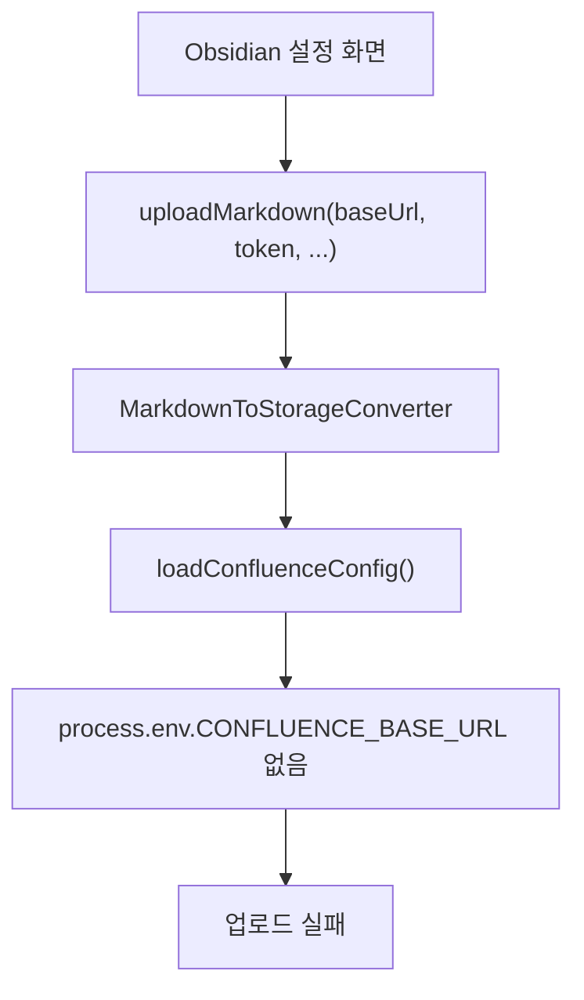

# Obsidian 업로드 환경설정 오류 수정

## 배경

Obsidian plugin 설정 화면에 `Confluence Base URL`과 `API Token`이 입력되어 있고 download는 성공하지만, upload 시 `CONFLUENCE_BASE_URL` 환경변수가 없다는 오류가 발생했다.

## 원인 가설

| 구간 | 설정 source | 동작 |
|---|---|---|
| Download | Obsidian plugin settings | 정상 |
| Upload API client | Obsidian plugin settings | 정상 |
| Markdown -> Storage 변환 | `loadConfluenceConfig()` env loader | 실패 |

`uploadMarkdown()`는 `new MarkdownToStorageConverter({ baseUrl })`로 Obsidian 설정값을 전달하지만, 실제 converter 생성자는 인자를 받지 않고 공통 env 설정을 로드한다. Obsidian runtime에는 CLI shell env가 없으므로 변환기 초기화 단계에서 `CONFLUENCE_BASE_URL` 오류가 발생한다.

## 수정 방향

| 항목 | 결정 |
|---|---|
| Converter API | optional options를 받아 `mermaidMacroName`, `inlineCodeStyle`을 주입 가능하게 한다. |
| Obsidian 동작 | options가 전달되면 env loader를 강제하지 않고 기본값을 사용한다. |
| CLI/MCP 동작 | options 없이 생성하면 기존처럼 `loadConfluenceConfig()` 값을 사용한다. |
| 테스트 | options 기반 생성자는 env config를 호출하지 않는 회귀 테스트를 추가한다. |
