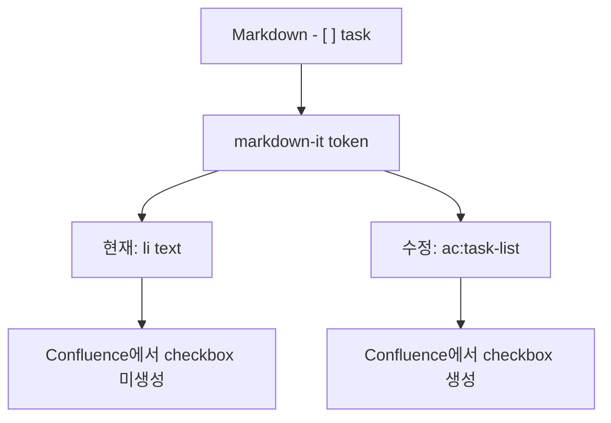

# Obsidian 체크박스 업로드 변환 수정

## 배경

Obsidian Markdown 문서의 task list 문법(`- [ ]`, `- [x]`)을 Confluence로 업로드하면 checkbox가 아니라 일반 bullet text로 표시된다.

## 확인한 입력

| 항목 | 값 |
|---|---|
| 로컬 문서 | `99. 【 🗑️ TEMPORARY 】/마인드맵 테스트.md` |
| Confluence page | `1046053424` |
| 증상 | `- [ ]`, `- [x]`가 checkbox로 생성되지 않고 text로 표시됨 |

## 원인

`MarkdownToStorageConverter`는 `markdown-it` 기본 renderer를 사용한다. 기본 renderer는 task list marker를 특별 처리하지 않으므로 다음처럼 일반 list item text로 렌더링한다.

| Markdown | 현재 Storage HTML |
|---|---|
| `- [ ] 체크박스` | `<li>[ ] 체크박스</li>` |
| `- [x] 체크박스` | `<li>[x] 체크박스</li>` |

Confluence Storage Format에서 checkbox는 일반 `<li>`가 아니라 `<ac:task-list>` 구조로 전달해야 한다.

## 수정 방향

| 항목 | 결정 |
|---|---|
| 처리 위치 | `MarkdownToStorageConverter` token renderer |
| unchecked | `<ac:task-status>incomplete</ac:task-status>` |
| checked | `<ac:task-status>complete</ac:task-status>` |
| 일반 bullet | 기존 `<ul><li>` 유지 |
| 테스트 | task-only list와 일반 bullet/task 혼합 list를 모두 검증 |

## 추가 수정

첫 수정 후 checked task 아래에 nested bullet이 있는 문서에서 Confluence가 `Unexpected close tag </ul>` 오류를 반환했다. 원인은 `<ac:task-body>`를 `list_item_close` 시점에 닫아 nested `<ul>`이 task body 내부로 들어갔기 때문이다.

| 문제 구조 | 수정 구조 |
|---|---|
| `<ac:task-body>체크박스<ul>...</ul></ac:task-body>` | `<ac:task-body>체크박스</ac:task-body><ul>...</ul>` |

task body는 task item의 첫 paragraph가 닫히는 시점에 바로 닫고, 하위 bullet은 task list 바깥의 일반 list로 렌더링하도록 변경했다.
