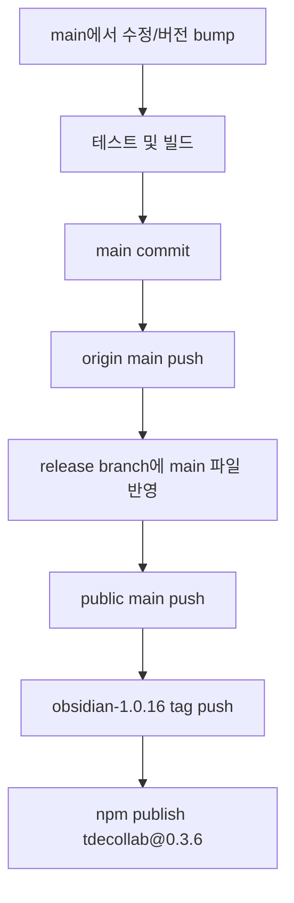

# Obsidian 체크박스 수정 릴리즈

## 릴리즈 범위

| 항목 | 내용 |
|---|---|
| 주요 수정 | Obsidian upload 시 Confluence Base URL 설정값 사용, Markdown checkbox를 Confluence task list로 변환 |
| Obsidian 릴리즈 버전 | `1.0.16` |
| Obsidian tag | `obsidian-1.0.16` |
| npm 패키지 버전 | `0.3.6` |
| public remote | `public` |
| public branch | `release:main` |

## 배포 순서

## 주의 사항

| 항목 | 결정 |
|---|---|
| npm 최신 버전 | registry 기준 `0.3.5` 확인 |
| npm 인증 | 로컬 `npm whoami`가 미인증 상태라 publish 전에 인증 필요 |
| release branch | orphan branch 운영 원칙을 유지하고 `git checkout main -- .` 방식으로 파일 내용만 반영 |

