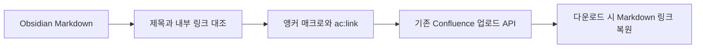

# Obsidian 업로드 목차 내부 링크 수정

## 원인과 범위

Obsidian 업로드의 `uploadMarkdown()`은 공용 `MarkdownToStorageConverter`를 호출한다.
`[설치 방법](#설치-방법)`은 일반 HTML 링크로 변환되지만, `<h2>설치 방법</h2>`에는 대응하는 앵커(Anchor)가 없다.
Confluence가 생성하는 제목 링크 규칙과 Markdown의 제목 식별자가 달라 페이지 내부 이동이 실패한다.
일반 입력으로 로컬 재현한 뒤, 사용자가 제공한 원본과 실제 페이지를 읽기 전용으로 대조했다.

| 확인 대상 | 결과 |
|---|---|
| 원격 보정 상태 | 앵커 59개, Confluence 내부 링크 68개 |
| 기존 업로드 변환 | 일반 `href="#…"` 68개, 앵커 0개 |
| 수정 후 변환 | 앵커 59개, Confluence 내부 링크 68개, 미변환 내부 링크 0개 |

따라서 기존 플러그인으로 재업로드하면 수작업 보정이 사라지고 문제가 재발한다.

## 설계 결정

| 대상 | 처리 |
|---|---|
| 같은 문서의 제목을 가리키는 Markdown 링크 | `ac:link ac:anchor`로 변환 |
| 링크 대상 제목 | 바로 앞에 `anchor` 매크로(Macro) 생성 |
| 식별자 | 제목의 표시 텍스트에서 소문자·문장부호 제거·공백의 하이픈 치환, 중복 시 숫자 접미사 |
| Obsidian의 제목 원문 링크 | URL 디코딩(Decoding) 후 제목 원문과도 대조 |
| 외부·다른 문서·일치하지 않는 링크 | 기존 변환 유지 |
| 다운로드 후 재업로드 | 다시 생성할 수 있는 제목 앵커의 내부 링크를 Markdown으로 복원. 사용자 정의 앵커는 기존 다운로드 범위 유지 |
| 구조 | 변환기에 구현하며 HTTP API·사용자 인터페이스의 책임 유지 |

## 검증 계획

1. 실패하는 회귀 테스트(Regression Test)를 먼저 작성하고 원인을 확인한다.
2. 한글·영문·인코딩(Encoding)·서식·중복 제목·일치하지 않는 링크를 검증한다.
3. 로컬 HTTP 서버로 실제 플러그인 업로드·조회·업데이트·다운로드·재업로드 경로의 자동화된 종단 간 테스트(E2E)를 수행한다.
4. 전체 테스트, 공용 도구와 플러그인 빌드(Build), 설계 적합성 코드 리뷰(Code Review)를 수행한다.
5. 실제 Confluence의 비저장 렌더링(Rendering) API로 원본 전체의 변환 결과를 검증하고, 화면 클릭 검증과 구분하여 기록한다.

## 참고

- [플러그인 설계](../specs/003-obsidian-confluence-plugin-design.md)
- [공용 변환기 아키텍처(Architecture)](../architecture.md#24-clituimcpobsidian-코드-관계)
- [Confluence 내부 링크 저장 형식(Storage Format)](https://confluence.atlassian.com/doc/confluence-storage-format-790796544.html)
- [Confluence 앵커 매크로](https://confluence.atlassian.com/doc/anchor-macro-182682072.html)

## 실행 결과

- 실패 재현: 새 회귀 테스트에서 내부 링크·앵커 생성·왕복 변환 누락을 확인한 뒤 구현했다. 실제 서버가 `ac:name` 앞에 `ac:macro-id`를 추가한 형식도 별도 실패 재현 후 수정했다.
- 최신 `origin/main`(`7c67b99`)에서 기존 테스트 130개가 통과했다. 동작을 바꾸기 전에 추가한 테스트 9개 중 7개가 내부 링크 또는 앵커 누락으로 실패했다.
- `pnpm test:run`: 23개 파일, 141개 테스트 통과. 신규 회귀 테스트 10개와 업로드 경로 종단 간 테스트(E2E) 1개를 포함한다.
- `pnpm --filter obsidian-tdecollab test --run`: 플러그인 테스트 22개 통과.
- 공용 도구와 플러그인의 프로덕션 빌드, `pnpm exec tsc --noEmit`: 통과. 플러그인은 GitHub Actions와 같은 Node.js 20 환경에서도 빌드했고, 산출물의 구문 및 매니페스트(Manifest) 버전 일치를 확인했다.
- `npm pack --dry-run`에서 배포 파일 25개를 확인했다. `npm pack`으로 만든 `tdecollab@0.4.2`를 임시 경로에 설치해 버전 출력, `tdecollab mcp`와 `tdecollab-server`의 표준 입출력(Stdio) 연결, `confluence_convert_content`의 목차 링크 왕복 변환을 검증했다.
- `pnpm lint`: ESLint가 설치되어 있지 않아 `eslint: command not found`로 미실행. 의존성을 임의 추가하지 않았다.
- 자동화된 종단 간 테스트(E2E): 실제 `uploadMarkdown()`·`downloadPage()`와 HTTP 클라이언트를 사용해 로컬 서버의 생성·조회·버전 증가·재업로드 및 XML 링크 대상 연결을 검증했다. Obsidian 화면과 실제 페이지 저장은 이 테스트 범위에 포함하지 않았다.
- 실제 원본 전체를 변환하고 다운로드·재업로드한 결과도 두 차례 모두 앵커 59개·내부 링크 68개로 동일했다.
- 실제 Confluence의 `POST /rest/api/contentbody/convert/view`에 변환된 본문과 페이지 문맥(`content`)을 보내 검증했다. 처음 확인한 원본은 내부 링크 68개가 모두 연결됐다. 새 릴리스 후보로 최신 원본을 다시 확인했을 때도 HTTP 200이었고, 내부 링크 86개와 앵커 62개가 렌더링됐으며 연결 대상이 없는 링크는 0개였다.
- 독립 코드 리뷰(Code Review)에서 사용자 정의 앵커가 제거되고 일반 텍스트 라벨의 CDATA 내용이 HTML로 해석되는 사례를 발견했다. 회귀 테스트로 재현한 후 제목에서 재생성할 수 있는 앵커만 처리하고, 라벨의 특수문자를 보존하도록 수정했다. 공용 변환기 재사용과 API 계층 분리, 기존 HTML 줄바꿈 정규화가 유지되는 것도 확인했다.
- 실제 페이지는 읽기와 비저장 렌더링만 수행했다. 원격 페이지 갱신·릴리스(Release)·병합은 수행하지 않았으며, 실제 Obsidian 화면에서 업로드 후 목차 클릭은 미검증이다.

## 릴리스 후보 버전

| 산출물 | 버전 | 버전 파일 |
|---|---|---|
| Obsidian 플러그인 | `1.0.19` | `packages/obsidian-plugin/manifest.json`, `packages/obsidian-plugin/package.json` |
| MCP·CLI·TUI npm 패키지 | `0.4.2` | 루트 `package.json` |

병합과 공개 GitHub 릴리스, npm 게시(Publish)는 사용자 검토 후 진행한다.
